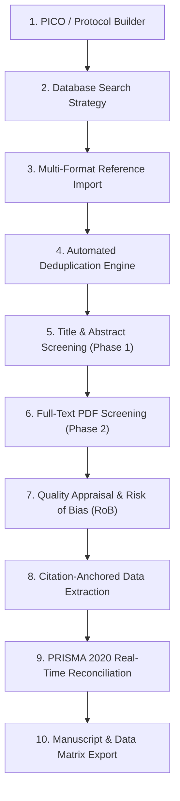

# BUKU PANDUAN LENGKAP & SPESIFIKASI SISTEM IB-SLR
**Platform SaaS Systematic Literature Review: *"From Literature to Evidence."***

---

## DAFTAR ISI
1. [Ringkasan Eksekutif & Value Proposition](#1-ringkasan-eksekutif--value-proposition)
2. [Spesifikasi Teknis & Arsitektur Sistem](#2-spesifikasi-teknis--arsitektur-sistem)
3. [Alur Kerja Riset End-to-End (The 10-Stage SLR Engine)](#3-alur-kerja-riset-end-to-end-the-10-stage-slr-engine)
4. [Katalog Input Data yang Didukung](#4-katalog-input-data-yang-didukung)
5. [Katalog Output & Berkas yang Dihasilkan](#5-katalog-output--berkas-yang-dihasilkan)
6. [Sistem Kuota, Monetisasi & Gateway Pembayaran](#6-sistem-kuota-monetisasi--gateway-pembayaran)
7. [Keamanan, Privasi & Kedaulatan Data Peneliti](#7-keamanan-privasi--kedaulatan-data-peneliti)
8. [Legalitas, Syarat Layanan & Integritas Publikasi](#8-legalitas-syarat-layanan--integritas-publikasi)

---

## 1. RINGKASAN EKSEKUTIF & VALUE PROPOSITION

### 1.1 Visi Produk
**IB-SLR** adalah perangkat lunak berbasis web (*Cloud SaaS*) kelas dunia yang dirancang khusus untuk memfasilitasi akademisi, mahasiswa pascasarjana, dosen, klinisi, dan lembaga riset dalam menjalankan **Systematic Literature Review (SLR)**, **Meta-Analysis**, dan **Scoping Review** sesuai standar metodologis internasional paling ketat (**PRISMA 2020 Statement** & **Cochrane Handbook**).

### 1.2 Masalah yang Diselesaikan
| Masalah Tradisional | Solusi yang Diberikan IB-SLR |
| :--- | :--- |
| **Pencatatan manual di Excel rawan hilang & error hitung** | Sistem database relasional otomatis merekonsiliasi seluruh angka PRISMA 2020 secara matematis. |
| **Duplikasi artikel antar database membuang waktu** | Algoritma deduplikasi cerdas mendeteksi kesamaan DOI dan judul dengan akurasi tinggi. |
| **Sulit melacak alasan eksklusi artikel (Title/Abstract vs Full-Text)** | Label alasan eksklusi terstandarisasi dengan audit trail tercatat waktu dan penilainya. |
| **Biaya software luar negeri sangat mahal ($200 - $1.000/tahun)** | Model fleksibel: **1 Proyek Gratis Selamanya**, top-up slot ekstra hanya **Rp 20.000 ($1.30)** via QRIS. |
| **Kekhawatiran data naskah rahasia bocor ke model AI publik** | Jaminan **Zero AI Model Training Guarantee** — naskah rahasia tidak pernah dipakai melatih AI publik. |

---

## 2. SPESIFIKASI TEKNIS & ARSITEKTUR SISTEM

* **Frontend Framework:** Next.js 15, React 19, Tailwind CSS.
* **Typografi & Visual:** Dual language (English & Bahasa Indonesia), Vector Branding Emblem Logo.
* **Backend Runtime:** Node.js serverless functions di Vercel Edge/Serverless.
* **Database & Penyimpanan:** Supabase PostgreSQL terenkripsi dengan Row-Level Security (RLS) multi-tenant.
* **Payment Engine:** Midtrans Production API terintegrasi QRIS Nasional, Virtual Account (BCA, Mandiri, BRI, BNI), dan E-Wallet.
* **Monetisasi Iklan:** Google AdSense terverifikasi resmi (`ca-pub-4685484644548395`).

---

## 3. ALUR KERJA RISET END-TO-END (THE 10-STAGE SLR ENGINE)

### Tahap 1: Inisiasi Proyek & Protocol Builder
* **Fungsi:** Merumuskan pertanyaan riset yang terstruktur sebelum studi dimulai agar memenuhi kaidah *PROSPERO Registration*.
* **Framework yang Didukung:**
  * **PICO:** *Population, Intervention, Comparator, Outcome* (studi klinis/intervensi).
  * **PEO:** *Population, Exposure, Outcome* (studi epidemiologi/observasional).
  * **SPIDER:** *Sample, Phenomenon of Interest, Design, Evaluation, Research type* (studi kualitatif).
* **Fitur Utama:** Kriteria Inklusi & Eksklusi terperinci, penguncian protokol (*Protocol Version Lock*) untuk mencegah bias perubahan pasca-analisis.

### Tahap 2: Strategi Pencarian Multi-Database (Search Formulation)
* **Fungsi:** Merancang string pencarian boolean tingkat lanjut untuk dieksekusi di database internasional.
* **Dukungan Basis Data:** PubMed/MEDLINE, Scopus, Web of Science, IEEE Xplore, Cochrane Central, Google Scholar, dan DOAJ.
* **Fitur Utama:** Generator operator Boolean (`AND`, `OR`, `NOT`), field tag search (`[tiab]`, `TITLE-ABS-KEY`), pelacak versi dan tanggal pencarian.

### Tahap 3: Import Referensi & Pengelolaan Sitasi
* **Fungsi:** Mengunggah ratusan hingga ribuan artikel ilmiah hasil pencarian database secara massal.
* **Fitur Utama:** Pengurai (*parser*) file kutipan standar RIS, BibTeX, dan CSV secara instan dengan deteksi otomatis kolom abstrak, penulis, jurnal, DOI, dan tahun.

### Tahap 4: Algoritma Deduplikasi Cerdas (Automated Deduplication)
* **Fungsi:** Menemukan dan menggabungkan artikel ganda hasil pencarian dari beberapa database yang berbeda.
* **Mekanisme Kerja:**
  * Pencocokan persis pada nomor **Digital Object Identifier (DOI)**.
  * Pencocokan kemiripan teks judul (*Levenshtein distance string normalization*) untuk artikel tanpa DOI.
  * Pencocokan kombinasi Nama Penulis Pertama + Tahun Publikasi.
* **Output:** Audit trail jumlah duplikat yang otomatis masuk ke kotak eksklusi duplikasi pada Diagram PRISMA 2020.

### Tahap 5: Screening Judul & Abstrak (Fase 1 Screening)
* **Fungsi:** Menyaring artikel yang relevan secara cepat hanya berdasarkan judul dan abstrak.
* **Fitur Utama:**
  * Navigasi kilat dengan tombol pintasan keyboard (*Include*, *Exclude*, *Maybe*).
  * Pelabelan alasan eksklusi terstandarisasi (*Wrong Population*, *Wrong Intervention*, *Non-English*, *Animal Study*, dsb.).
  * Rekonsiliasi konflik penilai ganda (*Dual-Reviewer Conflict Adjudication*).

### Tahap 6: Screening Full-Text & Pembaca PDF Terintegrasi (Fase 2 Screening)
* **Fungsi:** Memeriksa teks lengkap artikel untuk memastikan kelayakan metodologis mendalam.
* **Fitur Utama:**
  * *In-Browser PDF Viewer:* Membaca dan meninjau file dokumen PDF langsung di dalam workspace tanpa perlu aplikasi pihak ketiga.
  * Pencatatan alasan gugur teks lengkap sesuai standar pelaporan PRISMA 2020.

### Tahap 7: Penilaian Kualitas Metodologis & Risk of Bias (RoB)
* **Fungsi:** Menilai risiko bias metodologis dan mutu ilmiah dari setiap artikel yang lolos seleksi.
* **Instrumen Penilaian yang Tersedia:**
  * **Cochrane RoB 2:** Untuk uji klinis teracak (*Randomized Controlled Trials*).
  * **ROBINS-I:** Untuk studi intervensi non-acak.
  * **JBI Critical Appraisal:** Untuk studi observasional, kualitatif, dan prevalensi.
  * **Newcastle-Ottawa Scale (NOS) & CASP Checklist.**
* **Visualisasi:** Matriks warna lampu lalu lintas (*Traffic Light RoB Matrix*) dan diagram batang ringkasan risiko bias.

### Tahap 8: Matriks Ekstraksi Data (Data Extraction Matrix)
* **Fungsi:** Mengambil data kunci dan variabel temuan dari artikel yang disertakan (*Included Studies*).
* **Variabel Ekstraksi:** Desain studi, ukuran sampel, demografi partisipan, dosis/intervensi, instrumen ukur, temuan utama, *effect sizes* (Mean Difference, Odds Ratio, Risk Ratio, p-value).
* **Fitur Unggulan:** *Citation-Anchored Extraction* — setiap data yang diekstrak dapat ditautkan langsung ke kutipan kalimat di dalam PDF sumbernya.

### Tahap 9: Rekonsiliasi Diagram Alir PRISMA 2020 Dinamis
* **Fungsi:** Membuat diagram alir resmi PRISMA 2020 (*Page et al., BMJ 2021*) secara otomatis dan *realtime*.
* **Mekanisme Otomatis:**
  * $N_{\text{Identified}} = \text{Total referensi yang diimport}$
  * $N_{\text{Duplicates Removed}} = \text{Artikel ganda yang dibersihkan}$
  * $N_{\text{Screened}} = N_{\text{Identified}} - N_{\text{Duplicates Removed}}$
  * $N_{\text{Excluded Abstract}} = \text{Artikel tidak relevan pada Fase 1}$
  * $N_{\text{Full-Text Assessed}} = N_{\text{Screened}} - N_{\text{Excluded Abstract}}$
  * $N_{\text{Full-Text Excluded}} = \text{Artikel gugur teks lengkap dengan rincian alasan}$
  * $N_{\text{Included}} = \text{Studi akhir yang masuk sintesis kuantitatif/kualitatif}$
* Tidak akan ada selisih angka matematika karena dihitung secara deterministik oleh sistem.

### Tahap 10: Sintesis Bukti & Generator Laporan Publikasi
* **Fungsi:** Menyusun tabel karakteristik studi (*Summary of Findings Table*) dan mengekspor seluruh bukti ke dokumen publikasi jurnal ilmiah.

---

## 4. KATALOG INPUT DATA YANG DIDUKUNG

| Jenis Input | Format File / Sumber | Deskripsi & Kegunaan |
| :--- | :--- | :--- |
| **Kutipan Ilmiah (RIS)** | `.ris` (Research Information Systems) | Standar ekspor dari Scopus, PubMed, Mendeley, Zotero, EndNote. |
| **Bibliografi BibTeX** | `.bib` | Standar sitasi ilmiah untuk Google Scholar, IEEE Xplore, ACM, LaTeX. |
| **Tabel Sitasi CSV** | `.csv`, `.tsv` | Ekspor tabel kustom dari Scopus / Web of Science berisi judul, abstrak, DOI. |
| **Naskah Lengkap (PDF)** | `.pdf` (Portable Document Format) | Naskah teks lengkap artikel jurnal untuk dibaca dan diekstrak di browser. |
| **Pustaka EndNote XML** | `.xml` | Berkas perpustakaan referensi dari aplikasi Clarivate EndNote. |
| **Kueri Pencarian** | Teks Bebas / String Boolean | Sintaks kueri database (contoh: `("Artificial Intelligence") AND ("Systematic Review")`). |
| **Kriteria Protokol** | Form Interaktif | Deskripsi populasi, intervensi, komparator, hasil, serta batasan tahun terbit. |

---

## 5. KATALOG OUTPUT & BERKAS YANG DIHASILKAN

| Berkas / Laporan Output | Format Berkas | Keterangan & Manfaat untuk Peneliti |
| :--- | :--- | :--- |
| **Diagram Alir PRISMA 2020** | `.svg`, `.png`, PDF Cetak | Diagram alir beresolusi tinggi siap diunggah sebagai *Figure 1* di naskah jurnal internasional bereputasi (Q1/Q2). |
| **Matriks Ekstraksi Lengkap** | `.xlsx` (Microsoft Excel) | Tabel seluruh variabel studi terpilih, data demografi, ukuran sampel, dan temuan hasil riset. |
| **Dataset Bersih Terindeks** | `.csv` | Data tabular mentah yang siap dimasukkan ke software statistik lanjutan seperti RevMan, R Metafor, atau SPSS. |
| **Naskah Draf Metodologi** | `.docx` (Microsoft Word) | Draf bab metodologi SLR yang memuat narasi proses seleksi, strategi pencarian, dan tabel karakteristik studi. |
| **Koleksi Sitasi Terpilih** | `.bib`, `.ris` | Daftar referensi dari studi yang lolos (*Included Studies*) untuk diimpor langsung ke manajer referensi (Mendeley/Zotero). |
| **Laporan Risiko Bias (RoB)** | PDF / Matriks Visual | Tabel penilaian RoB 2 / JBI lengkap dengan skor mutu per domain metodologi. |
| **Faktur Resmi (Invoice)** | Halaman Cetak & PDF | Faktur pembayaran berstempel verifikasi resmi lengkap dengan Order ID, nama pembeli, rincian item, dan tanggal transaksi. |

---

## 6. SISTEM KUOTA, MONETISASI & GATEWAY PEMBAYARAN

### 6.1 Struktur Paket & Harga (Dual-Currency Standard)
* **Academic Free:** **$0** (Gratis Selamanya — 1 Proyek Aktif Lengkap)
* **Pay-Per-Project Pass:** **$1.30 USD** (~Rp 20.000 IDR / 1x proyek aktif permanen)
* **Professional Researcher:** **$29.00 USD** (~Rp 450.000 IDR / bulan — Unlimited Proyek, Dual Reviewers, RoB 2 / JBI)
* **Institutional & Lab:** **$99.00 USD** (~Rp 1.500.000 IDR / bulan — Unlimited Seats, SAML SSO, Audit Log)

### 6.2 Gateway Pembayaran Resmi
* **Enkripsi:** PCI-DSS Level 1 berstandar perbankan nasional.
* **Metode Pembayaran:** QRIS Bank Indonesia (BCA, Mandiri, BRI, BNI, GoPay, OVO, Dana, ShopeePay), Virtual Account Bank, E-Wallet, dan Kartu Kredit/Debit.
* **Otomasi Realtime:** Webhook SHA-512 + Polling 3 detik mengaktifkan kuota secara instan.

### 6.3 Monetisasi Iklan (Google AdSense)
* Terintegrasi dengan publisher resmi `ca-pub-4685484644548395`.
* Dilengkapi file `ads.txt` terverifikasi di direktori publik root.

---

## 7. KEAMANAN, PRIVASI & KEDAULATAN DATA PENELITI

### 7.1 Jaminan Nol Pelatihan AI (Zero AI Model Training Guarantee)
Naskah artikel ilmiah, draf manuskrip, file PDF berhak cipta, dan data ekstraksi yang diunggah ke IB-SLR **DIJAMIN 100% TIDAK PERNAH digunakan untuk melatih model AI publik, komersial, atau model dasar pihak ketiga**.

### 7.2 Isolasi Privasi Multi-Tenant (Tenant Isolation)
* Setiap akun pengguna memiliki partisi data yang independen di basis data PostgreSQL.
* Proyek hanya dapat diakses apabila `project.createdBy === session.userId`. Pengguna lain tidak dapat melihat atau membaca data proyek Anda.

### 7.3 Kepatuhan Hukum Perlindungan Data
* Memenuhi **UU Pelindungan Data Pribadi (UU PDP No. 27/2022)** dan **GDPR**.
* Enkripsi sesi dengan *signed HMAC HTTP-Only cookie* dan kata sandi *salted bcrypt*.

---

## 8. LEGALITAS, SYARAT LAYANAN & INTEGRITAS PUBLIKASI

### 8.1 Kepemilikan Hak Kekayaan Intelektual (100% Milik Peneliti)
Peneliti memiliki hak cipta mutlak atas seluruh karya, sintesis, dan manuskrip akhir. IB-SLR tidak mengambil hak cipta atau royalti apapun.

### 8.2 Kebijakan Garansi Pengembalian Dana 7 Hari (100% Refund Policy)
Jaminan uang kembali penuh dalam waktu 7 hari jika slot proyek pass belum digunakan untuk screening atau ekstraksi.

### 8.3 Kepatuhan Etika Akademik (Academic Integrity & Plagiarism Standards)
Fitur AI difungsikan murni sebagai asisten penyaring awal; peneliti memegang tanggung jawab metodologis penuh dan didukung riwayat audit transparan (*audit ledger*).

---

*Disusun secara resmi untuk platform **IB-SLR** ([ib-slr-app.vercel.app](https://ib-slr-app.vercel.app)).*
